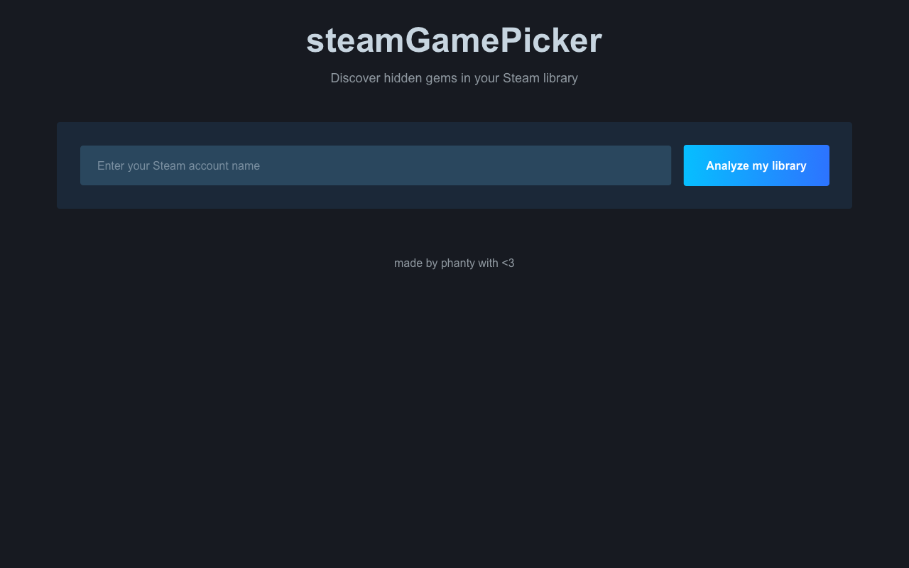

# 🎮 Steam Game Picker

[**Live demo →**](https://steam-game-picker-kappa.vercel.app/)

Pick your next game from your Steam library instead of staring at it. Enter a
Steam account name, the app loads the owned games and surfaces a recommendation,
with filters for top-rated titles.



## ✨ Features

- 🎲 Random game picker from a Steam library
- 🏆 Filter by top-rated games (Metacritic scores)
- 🎨 Steam-themed dark UI
- ⚡ Next.js App Router, server-side API routes, client-side cache

## 🚀 Getting started

### Prerequisites

- Node.js 20.9+ (built with Node 22)
- A Steam account and a [Steam Web API key](https://steamcommunity.com/dev/apikey)
  (free)
- The Steam profile must be public so the library can be read

### Installation

1. **Clone the repository**

   ```bash
   git clone https://github.com/Phanty78/steam-game-picker.git
   cd steam-game-picker
   ```

2. **Install dependencies**

   ```bash
   npm ci
   ```

3. **Configure the environment**

   ```bash
   cp .env.example .env
   ```

   ```env
   STEAM_API_KEY=your_steam_api_key_here
   ```

   **How to get a Steam API key**

   - Visit <https://steamcommunity.com/dev/apikey>
   - Log in with your Steam account
   - Register a key (any domain works, e.g. `localhost`)
   - Copy the key into `.env`

4. **Run the development server**

   ```bash
   npm run dev
   ```

5. **Open** <http://localhost:3000>

### Production build

```bash
npm run build
npm run start
```

`npm run lint` runs ESLint with the Next.js configuration.

## 🔌 API routes

| Route | Purpose |
| --- | --- |
| `GET /api/steam/resolve?id=<vanity>` | Resolve a Steam account name to a Steam ID |
| `GET /api/steam/library?id=<steamid>` | Fetch the owned games of a Steam ID |
| `GET /api/steam/details?appids=<csv>` | Fetch store details for up to 100 app IDs |

`STEAM_API_KEY` is read server-side only. Without it, `/api/steam/library` and
`/api/steam/resolve` answer with an explicit configuration error.

## 🛠️ Tech stack

- **Framework**: [Next.js 16](https://nextjs.org/) (App Router)
- **Language**: TypeScript
- **Styling**: Tailwind CSS 4
- **API**: Steam Web API and Steam Store API

## 🤝 Contributing

Issues and pull requests are welcome. Keep a pull request focused on one change,
run `npm run lint` and `npm run build` before opening it, and describe what you
tested.

## 📝 License

[Apache License 2.0](LICENSE).

## 🙏 Acknowledgments

- Built with [Next.js](https://nextjs.org/)
- Powered by the [Steam Web API](https://steamcommunity.com/dev)
- Inspired by having too many games and nothing to play

---

**Happy gaming!** 🎮
